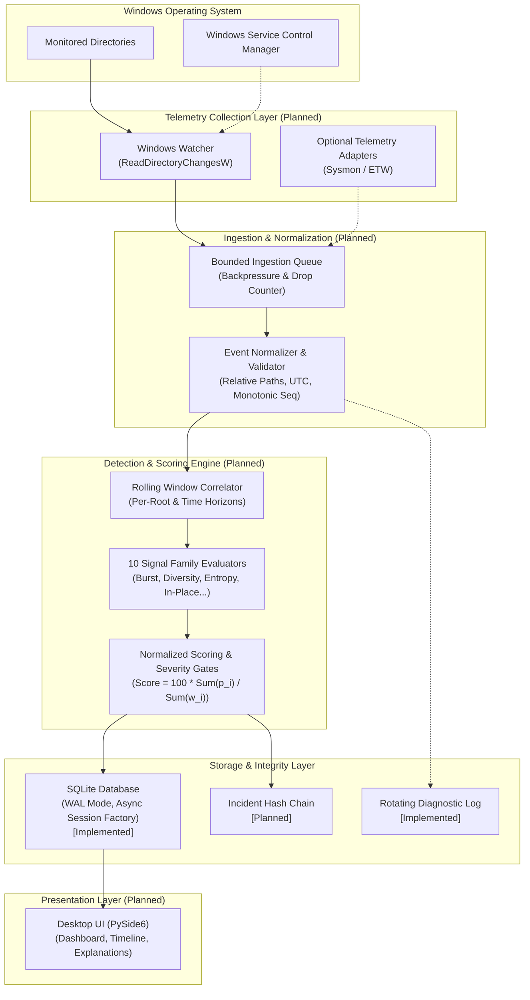

# Kuyebiko — System Architecture and Technical Design

## 1. Project Overview

### 1.1 What Kuyebiko Is
**Kuyebiko** is an open-source, local-first endpoint monitoring and incident investigation platform designed for Windows (primarily 64-bit Windows 11). It observes filesystem activity across user-selected directories and correlates event patterns to detect behaviours characteristic of ransomware or destructive file manipulation.

### 1.2 Primary Objectives
- **Local Observation:** Monitor user-designated directories without requiring cloud connectivity, external agents, or remote telemetry transmission.
- **Multi-Signal Behavioural Correlation:** Move beyond simple file-write thresholds by combining independent signal families into unified detection windows.
- **Explainable Incident Generation:** Provide clear, auditable incident records that expose contributing signals, observed values, thresholds, weights, and telemetry health.
- **Uncertainty Quantification:** Explicitly convey telemetry quality, missing collectors, and confidence levels rather than masking coverage gaps behind false reassurances.
- **Safe Defensive Guidance:** Supply structured, non-destructive remediation suggestions (e.g., network isolation, forensic preservation) without executing autonomous destructive actions.

### 1.3 Intended Users
- **Individual Windows Users:** Seeking transparent, lightweight visibility into whether sensitive local documents or media directories are under attack.
- **Cybersecurity Students & Researchers:** Requiring a reproducible, inspectable platform to study ransomware behaviour patterns and test detection hypotheses against synthetic datasets.
- **Small Technical Teams & Developers:** Needing local directory monitoring across developer workstations or internal shares without deploying heavyweight enterprise EDR infrastructure.

### 1.4 Local-First Design Philosophy
Kuyebiko is architected around complete data sovereignty:
- All event ingestion, queue management, correlation, risk scoring, and database storage occur strictly on the local host.
- File contents, document previews, cryptographic keys, and user credentials are **never** inspected, collected, or persisted.
- Core operations remain fully functional in an offline or air-gapped environment.

### 1.5 Complementary Role Beside Microsoft Defender
Kuyebiko is **not** an antivirus, EDR replacement, or backup recovery mechanism. It serves as an explainable visibility and investigation layer that coexists with native Windows security features (such as Microsoft Defender Antivirus and Controlled Folder Access). Kuyebiko does not attempt to hook kernel drivers, replace endpoint protection, or autonomously terminate processes in its MVP baseline.

---

## 2. Architectural Principles

1. **Modular Architecture:** Subsystems (collectors, normalizers, detection engines, storage, presentation) are decoupled behind clean interfaces, facilitating independent testing and evolution.
2. **Separation of Concerns:** The background monitoring engine is isolated from user-facing presentation layers, preventing user-interface closures from halting directory monitoring.
3. **Local Data Processing:** Telemetry is processed in-memory and persisted into a local SQLite repository. No outbound network requests are made for core analysis.
4. **Minimal Data Collection:** The agent captures only structural filesystem metadata (paths, actions, sequence numbers, timestamps). File contents are never ingested.
5. **Testability & Deterministic Replay:** Event models and detection logic can be driven by recorded JSONL fixtures, enabling reproducible regression testing without live filesystem operations.
6. **Explainable Detection:** Risk scoring is transparent, additive, and normalized. Every alert explicitly details why it was raised, which signals contributed, and which telemetry streams were unavailable.
7. **Reliability & Fault Isolation:** Event queues are bounded to prevent memory exhaustion, watcher buffer overflows trigger explicit `DEGRADED` health states, and database operations use ACID transactions with WAL mode.

---

## 3. Technology Stack

### 3.1 Implemented Technologies (Current Baseline)
The initial architectural foundation is implemented and validated in Python 3.12+ (tested on Python 3.14):

| Technology | Role | Status |
| :--- | :--- | :--- |
| **Python >=3.12** | Core language runtime | Implemented |
| **Pydantic v2.10+** | Strict data validation, schema enforcement, path sanitization | Implemented |
| **Pydantic Settings v2.7+** | Environment-aware application configuration (`KuyebikoSettings`) | Implemented |
| **SQLAlchemy v2.0+ (asyncio)** | Asynchronous database engine, connection pooling, and session factory | Implemented |
| **aiosqlite v0.20+** | Non-blocking asynchronous SQLite driver | Implemented |
| **SQLite 3** | Local-first relational storage, WAL mode, integrity verification | Implemented |
| **RotatingFileHandler** | Centralized rotating diagnostic logging (5 MB × 5 backups) | Implemented |
| **pytest v8.0+ / pytest-cov** | Unit testing harness and code coverage reporting | Implemented |
| **Ruff v0.9+** | High-performance linting, formatting, and Python 3.12+ modernization | Implemented |

### 3.2 Planned Technologies (Future Phases)
The following components are planned for subsequent implementation stages:

| Technology | Role | Status |
| :--- | :--- | :--- |
| **Windows API (`ReadDirectoryChangesW`)** | High-throughput directory change notifications via ctypes/win32 | Planned (Phase 1/2) |
| **Windows Service Control Manager (SCM)** | Background service execution, auto-recovery, and watchdog supervision | Planned (Phase 4) |
| **Sysmon / ETW Adapters** | Optional process attribution and recovery-interference telemetry | Planned (Phase 2+) |
| **PySide6 (Qt for Python)** | Local desktop user interface, real-time dashboard, and incident viewer | Planned (Phase 3) |
| **Cryptographic Hash Chaining** | SHA-256 tamper-evident chaining across persisted incident records | Planned (Phase 4) |

---

## 4. Module Responsibilities

The codebase under `src/kuyebiko/` is organized into single-responsibility packages:

```
src/kuyebiko/
├── __init__.py          # Package root
├── main.py              # Application entry point (planned lifecycle orchestration)
├── core/                # Central configuration, constants, exceptions
├── models/              # Pydantic schemas for events, incidents, telemetry
├── collectors/          # Filesystem and OS telemetry collection adapters
├── processing/          # Ingestion queue, normalizer, and event deduplication
├── detection/           # Rolling window correlation and signal scoring engines
├── storage/             # SQLite connection management and database migrations
├── integrity/           # Hash chaining, manifest checks, and tamper resistance
├── application/         # Windows service runner, IPC handler, and desktop UI
└── utils/               # Centralized logging and general-purpose helpers
```

### Module Breakdown

- **`core/`**:
  - `config.py` *(Implemented)*: Houses `KuyebikoSettings`, handling application settings, database paths, queue limits, retention policies, and logging levels via `pydantic-settings`.
  - `constants.py` *(Planned)*: Shared constants, default weights, and threshold bounds.
  - `exceptions.py` *(Planned)*: Domain-specific exceptions (`CollectionError`, `IntegrityError`, etc.).
- **`models/`**:
  - `events.py` *(Implemented)*: Defines `FileEvent`, `EventType`, `EventSource`, and `TelemetryQuality` with strict validators against path traversal and malformed rename operations.
  - `incidents.py` *(Implemented)*: Defines `SecurityIncident`, `IncidentSeverity`, `IncidentConfidence`, and `IncidentStatus` with score boundaries (0–100) and chronological validation.
  - `telemetry.py` *(Implemented)*: Defines `TelemetrySnapshot`, `MonitoringStatus`, and `CollectorStatus` tracking queue depth, dropped events, and collector degradation.
- **`collectors/`** *(Planned)*:
  - Directory watcher based on Windows `ReadDirectoryChangesW`.
  - Bounded ring buffers and overflow accounting.
  - Optional adapters for external process telemetry (e.g., Sysmon).
- **`processing/`** *(Planned)*:
  - Event normalization and monotonic sequence ordering.
  - Bounded event queue with backpressure handling.
  - Path canonicalization and exclusion filtering.
- **`detection/`** *(Planned)*:
  - Sliding time-window correlation engine.
  - 10 behavioural signal evaluators (burst, rename/delete ratio, file diversity, etc.).
  - Normalized scoring algorithm and severity gating logic.
- **`storage/`**:
  - `database.py` *(Implemented)*: Asynchronous `Database` class configuring SQLite pragmas (`WAL`, `busy_timeout=30s`, `foreign_keys=ON`, `synchronous=NORMAL`), connectivity checks, and integrity verification.
  - `migrations/` *(Planned)*: Schema migration scripts for relational incident and event tables.
- **`integrity/`** *(Planned)*:
  - Cryptographic hash chaining over persisted incidents.
  - Binary manifest validation on startup.
- **`application/`** *(Planned)*:
  - Service lifecycle management and heartbeat generation.
  - Inter-Process Communication (IPC) between service and desktop UI.
  - PySide6 graphical interface.
- **`utils/`**:
  - `logging_config.py` *(Implemented)*: Centralized rotating file and console logger setup via `configure_logging()`.

---

## 5. Data Flow & Processing Pipeline

The intended data processing pipeline routes filesystem observations from the Windows kernel to persistent local storage and user investigation screens:



### Implementation Status Matrix

| Pipeline Stage | Component | Current Implementation Status |
| :--- | :--- | :--- |
| **Event Definition** | `FileEvent`, `EventType`, `EventSource` | **Implemented** (Model validated with unit tests) |
| **Event Ingestion** | `ReadDirectoryChangesW` Watcher | **Planned** |
| **Queue & Backpressure** | Bounded event queue with drop tracking | **Planned** (Telemetry schema implemented) |
| **Normalization** | Path sanitization, timezone alignment | **Partially Implemented** (Model validators active) |
| **Window Correlation** | Rolling time-window aggregator | **Planned** |
| **Signal Evaluators** | 10 behavioural signal algorithms | **Planned** |
| **Risk Scoring** | Normalized formula and severity gating | **Planned** (Incident schema implemented) |
| **Storage Engine** | Asynchronous SQLite connection & WAL | **Implemented** (Database class & integrity checks) |
| **Incident Persistence** | Relational incident and event tables | **Planned** (Pydantic schema implemented) |
| **Diagnostic Logging** | Centralized rotating file logger | **Implemented** (Logging configuration active) |
| **Desktop Presentation**| PySide6 GUI and incident inspector | **Planned** |

---

## 6. Data Models

The core data structures are implemented using Pydantic v2 with strict validation and immutability settings:

### 6.1 `FileEvent` (`src/kuyebiko/models/events.py`)
Encapsulates an observed filesystem operation:
- **`event_id`**: Globally unique UUID string identifying the event.
- **`root_id`**: Identifier of the monitored root directory.
- **`file_path`**: Relative path from the monitored root. Enforces relative format, rejects absolute Windows paths (e.g., `C:\...`), and rejects path traversal sequences (`..`).
- **`event_type`**: Enumeration (`created`, `modified`, `renamed`, `deleted`).
- **`old_path` / `new_path`**: Optional relative path strings. Enforced to be present if and only if `event_type == renamed`, with `file_path == new_path`.
- **`timestamp_utc`**: Timezone-aware UTC datetime.
- **`monotonic_ns`**: Non-negative integer from the system monotonic clock to ensure chronological order immune to clock skew.
- **`source`**: Telemetry origin (`windows_watcher`, `sysmon`, `etw`, `simulator`).
- **`sequence_number`**: Non-negative monotonically increasing counter per source.
- **`quality`**: Telemetry condition flag (`normal`, `delayed`, `degraded`, `recovered`).

### 6.2 `SecurityIncident` (`src/kuyebiko/models/incidents.py`)
Represents a correlated security alert resulting from behavioural evaluation:
- **`incident_id`**: Unique UUID string.
- **`root_id`**: Monitored root where anomalous behaviour was detected.
- **`title`**: Concise human-readable summary (1–200 characters).
- **`description`**: Detailed explanation of detected activity (1–2000 characters).
- **`severity`**: Categorical threat level (`informational`, `low`, `medium`, `high`, `critical`).
- **`confidence`**: Telemetry quality rating (`high`, `moderate`, `low`, `insufficient`).
- **`risk_score`**: Integer bounded between 0 and 100 inclusive.
- **`status`**: Lifecycle state (`open`, `acknowledged`, `resolved`, `false_positive`). Default: `open`.
- **`first_seen` / `last_seen`**: Timezone-aware UTC datetimes. Enforces `last_seen >= first_seen`.
- **`evidence_event_ids`**: List of unique, non-empty `event_id` strings linking the incident directly to raw supporting events.
- **`signal_families`**: List of unique behavioural signal family names that contributed to the alert.

### 6.3 `TelemetrySnapshot` (`src/kuyebiko/models/telemetry.py`)
Tracks health, throughput, and collector degradation:
- **`snapshot_id`**: Unique UUID string.
- **`collector_id` / `root_id`**: Identifiers for the telemetry agent and monitored root.
- **`monitoring_status`**: Overall health state (`running`, `degraded`, `stopped`, `error`).
- **`collector_status`**: Adapter state (`active`, `inactive`, `degraded`, `error`).
- **`events_received` / `events_dropped`**: Cumulative non-negative event counters.
- **`queue_capacity` / `queue_depth`**: Queue saturation metrics. Enforces `queue_depth <= queue_capacity`.
- **`collection_errors`**: Cumulative count of collector-level API errors.
- **`last_heartbeat` / `last_event_at`**: Optional timezone-aware UTC timestamps.
- **`observed_at`**: Snapshot capture timestamp (UTC).
- **`degradation_reasons`**: Unique, non-empty list of diagnostic explanation strings describing why the system is in a degraded state.

---

## 7. Database Architecture

The local database infrastructure is implemented in `src/kuyebiko/storage/database.py` using asynchronous SQLAlchemy 2.0 with the `aiosqlite` driver:

### 7.1 Connection Management & Pragmas
When a connection is established, Kuyebiko automatically configures SQLite pragmas for resilience and performance:
- **`PRAGMA foreign_keys = ON;`**: Enforces referential integrity across relational entities.
- **`PRAGMA busy_timeout = 30000;`**: Sets a 30-second lock timeout to eliminate immediate `database is locked` errors during concurrent access.
- **`PRAGMA journal_mode = WAL;`**: Activates Write-Ahead Logging. WAL allows concurrent readers to proceed without blocking writers and vice versa, dramatically improving UI responsiveness during heavy event ingestion.
- **`PRAGMA synchronous = NORMAL;`**: Provides durability for application crashes while minimizing disk I/O bottlenecks in WAL mode.

### 7.2 Database Operations
- **`initialize()`**: Asynchronously establishes connectivity and ensures the database file and parent directories exist.
- **`health_check()`**: Returns a boolean indicating whether the database is accessible by executing `SELECT 1`.
- **`integrity_check()`**: Executes SQLite's built-in `PRAGMA integrity_check` and returns the engine status (e.g., `"ok"`).
- **`close()`**: Cleanly disposes of the asynchronous engine pool.

*Note on relational tables:* Relational schema tables (e.g., `events`, `incidents`, `monitored_roots`) are scheduled for implementation in Phase 2 via SQLAlchemy ORM mappings and migration scripts. The current `Database` implementation manages connection lifecycles, directory creation, engine configuration, and integrity verification.

---

## 8. Deployment Architecture

Kuyebiko is architected as a Windows desktop application designed to run locally on Windows 11 systems:

```
┌────────────────────────────────────────────────────────┐
│                   Windows User Session                 │
│                                                        │
│  ┌──────────────────────────────────────────────────┐  │
│  │         Kuyebiko Desktop UI (PySide6)            │  │
│  │  - Dashboard & Event Rates                       │  │
│  │  - Incident Timeline & Signal Breakdown          │  │
│  │  - Folder Management & Suppression Controls      │  │
│  └────────────────────────▲─────────────────────────┘  │
│                           │ Local IPC / SQLite WAL     │
│  ┌────────────────────────▼─────────────────────────┐  │
│  │           Kuyebiko Background Service            │  │
│  │  - ReadDirectoryChangesW Watcher                 │  │
│  │  - In-Memory Event Queue & Normalizer            │  │
│  │  - Rolling Window Behaviour Engine               │  │
│  │  - SQLite WAL Repository (data/kuyebiko.db)      │  │
│  └──────────────────────────────────────────────────┘  │
└────────────────────────────────────────────────────────┘
```

### 8.1 Service vs. UI Decoupling
To ensure monitoring persistence:
- The core monitoring and detection loop is designed to execute as an independent background service.
- If the user closes the desktop UI, the background service continues monitoring directories, populating the queue, evaluating signals, and recording incidents into SQLite.
- The UI connects locally to inspect database records, read telemetry snapshots, and adjust configuration settings.

### 8.2 Security Context & Least Privilege
- Kuyebiko operates in user-mode with least privilege.
- Directory monitoring requires standard read and directory notification permissions on selected folders.
- Administrative elevation is requested only for optional low-level OS telemetry adapters (e.g., ETW session creation) and is never required for standard directory change monitoring.

---

## 9. Architecture Evolution

The system architecture is structured to evolve across planned delivery milestones:

1. **Phase 1 (Current — Foundation):**
   - Core Pydantic schemas (`FileEvent`, `SecurityIncident`, `TelemetrySnapshot`).
   - Configuration management (`KuyebikoSettings`).
   - Asynchronous SQLite WAL infrastructure (`Database`).
   - Centralized rotating logging (`logging_config.py`).
   - Unit test suite (44 tests, 94% coverage).
2. **Phase 2 (Monitoring & Ingestion):**
   - Windows `ReadDirectoryChangesW` collector.
   - Bounded event queue with drop accounting and backpressure.
   - Event normalization and directory path canonicalization.
3. **Phase 3 (Detection & Scoring):**
   - Time-window correlation engine.
   - 10 behavioural signal evaluators.
   - Normalized scoring algorithm and severity gates.
   - Relational database schema migrations for incidents and raw events.
4. **Phase 4 (Presentation & Integrity):**
   - PySide6 desktop interface (dashboard, incident inspector, settings).
   - Tamper-evident cryptographic hash chaining on incident records.
   - Sandboxed synthetic behavior simulator for safe verification.
5. **Phase 5 & 6 (Validation & Release):**
   - Labeled benchmark suite and reproducible validation against benign workloads.
   - Packaging, installer, and public release documentation.
